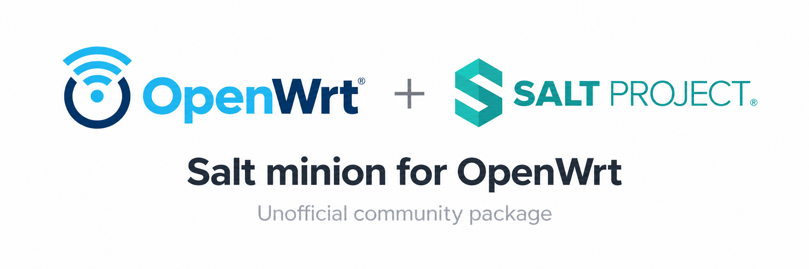

# saltstack-wrt: Install and configure a router minion



This project provides Salt 3008.3 minion packages for OpenWrt and Turris OS.
The packages use TCP transport and include optional router modules.
The Salt master runs on a separate computer.

## Salt documentation

| Topic | Official Salt 3008 documentation |
| --- | --- |
| Configure a minion | [Minion configuration](https://docs.saltproject.io/en/3008/ref/configuration/minion.html) |
| Configure a master | [Master configuration](https://docs.saltproject.io/en/3008/ref/configuration/master.html) |
| Use TCP transport | [TCP transport](https://docs.saltproject.io/en/3008/topics/transports/tcp.html) |
| Write and apply states | [Salt states tutorial](https://docs.saltproject.io/en/3008/topics/tutorials/starting_states.html) |

## 1. Select packages for the router

Use the output for your target system:

| Target | System | Architecture | Package output |
| --- | --- | --- | --- |
| Turris Omnia | Turris OS 9.1.1 | `arm_cortex-a9_vfpv3-d16` | `openwrt/output/omnia/` |
| OpenWrt x86_64 | OpenWrt 24.10.8 | `x86_64` | `openwrt/output/x86_64/` |

When you use the test repository's build wrappers, these paths are in that repository.
When you build the package repository directly, they are in the package repository.

Check the router before you select IPK files:

```sh
cat /etc/os-release
opkg print-architecture
df -h /overlay /tmp
```

| Package | Purpose |
| --- | --- |
| `python3-salt` | Shared Python runtime. Required. |
| `salt-minion` | Minion commands, configuration, and init script. Required. |
| `minion-opkg` | Package management through `pkg.*`. Optional. |
| `minion-uci` | UCI functions, UCI states, and `wrt_config`. Optional. |
| `minion-service` | Service management through procd and ubus. Optional. |
| `minion-openwrt` | Metapackage that requires all router add-ons. Optional. |

The complete profile includes all six packages.
For a minimal installation, use the two required packages and the needed dependencies.
Add only the modules you need; omit `minion-openwrt` if you omit an add-on.
The add-ons must match the base Salt package release.

For the complete profile, use `install-local.txt` from the target output directory.
It lists the local IPK files, including any local Python compatibility packages.
Copy every listed IPK and the manifest to `/tmp/salt-ipk/` on the router.
Use the exact filenames in the manifest.

Do not install every exported IPK with `opkg install *.ipk`.
The export also includes system dependencies for build and test use.
The router's configured feeds should supply existing system dependencies.
`install-all.txt` lists the full dependency export; it is not the router installation list.

## 2. Configure the minion before installation

On the router, create the configuration directory:

```sh
mkdir -p /etc/salt/minion.d
```

Create `/etc/salt/minion.d/local.conf`:

```yaml
master: 192.168.1.10
id: openwrt-test
transport: tcp
master_port: 4506
```

Use your master's address and a unique minion ID.
Keep `transport: tcp`; the package does not include ZeroMQ support.
This file overrides the shipped minion defaults through Salt's `minion.d/*.conf` include.

The example uses a TCP master on its standard request port, 4506.
For a dedicated TCP master, set `transport: tcp` in `/etc/salt/master.d/tcp.conf`
and restart the master.
The minion must also reach the master's TCP publication port, normally 4505.

The shipped router configuration uses port 4606 for the test repository's mixed-transport master.
For that master or the playground, use `master_port: 4606` instead.
Its TCP publication port is 4605.
Match the port to your master's actual configuration.

`minion-service` installs its provider selection in
`/etc/salt/minion.d/20-openwrt-service.conf`.
You do not need an additional provider file for opkg, UCI, or `wrt_config`.

## 3. Install and start the minion

For an upgrade, stop the existing minion locally before installation.
Upgrade the base packages and all installed add-ons together.
Do not use force options to bypass dependency checks.

For the complete profile, install the local files in one opkg call.
On the router, execute:

```sh
cd /tmp/salt-ipk
opkg update
```

Continue only if the feed update succeeds.
Load the filenames from the manifest and install them:

```sh
set --
while IFS= read -r ipk; do
    [ -z "$ipk" ] || set -- "$@" "$ipk"
done < install-local.txt
[ "$#" -gt 0 ] && opkg install "$@"
```

Continue only if installation succeeds.

OpenWrt starts and enables the minion during a fresh installation.
Turris uses its system service policy and can leave an unlisted service disabled.
After installation, execute locally:

```sh
salt-call --local test.ping
/etc/init.d/salt-minion enable
/etc/init.d/salt-minion restart
/etc/init.d/salt-minion status
```

Restart after configuration or add-on changes so that the running minion loads them.

## 4. Accept the key and test the connection

On the router, read the minion key fingerprint:

```sh
salt-call --local key.finger
```

On the master, inspect the key for the same minion ID:

```sh
salt-key -f openwrt-test
```

Compare the fingerprints. Accept the key only if they match:

```sh
salt-key -a openwrt-test
salt openwrt-test test.ping
```

A successful ping returns `True`.
For connection problems, inspect `logread` and `/var/log/salt/minion` on the router.

## Router module guides

| Module | Use it to | Guide |
| --- | --- | --- |
| `pkg` | Install missing packages and remove installed packages. | [opkg](opkg.md) |
| `uci` | Read configuration and use a separate commit step. | [UCI](uci.md) |
| `wrt_config` | Manage and save one UCI configuration in one state. | [wrt_config](wrt-config.md) |
| `service` | Manage procd services and apply saved configuration. | [service/procd](service.md) |
